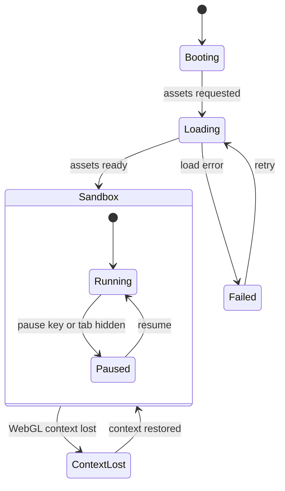
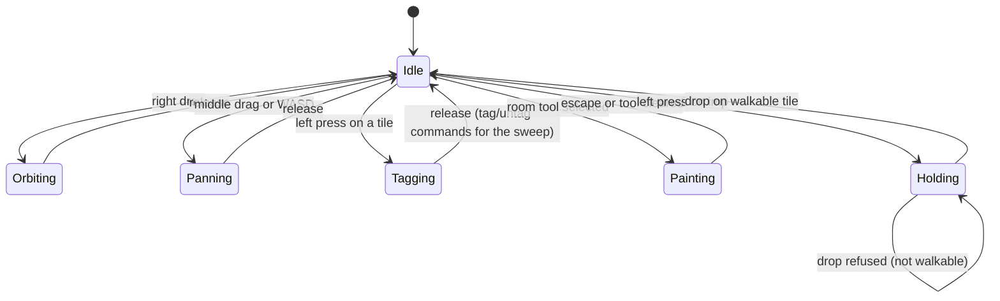
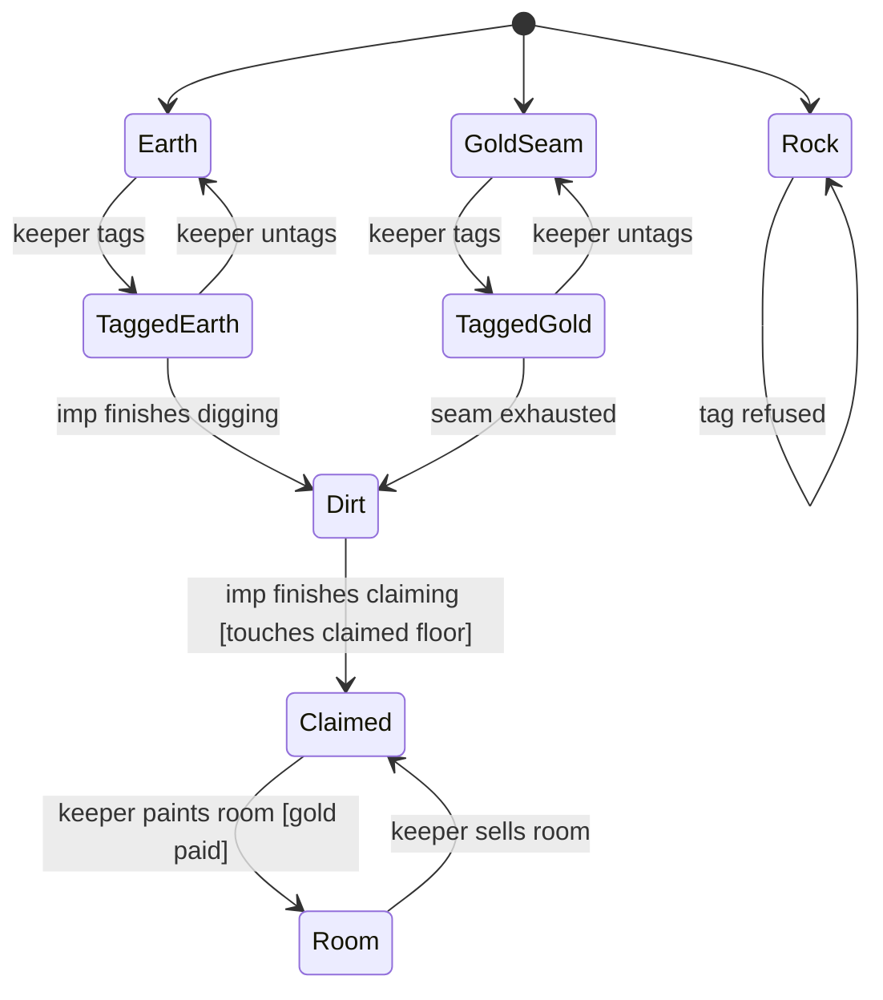
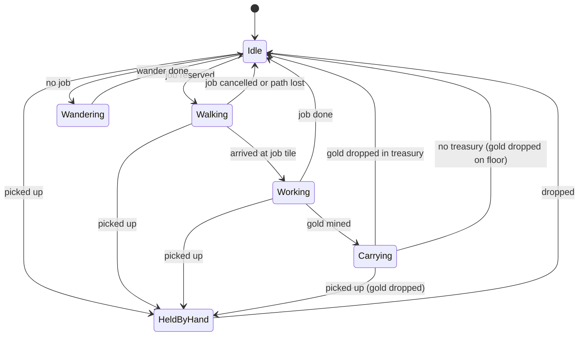
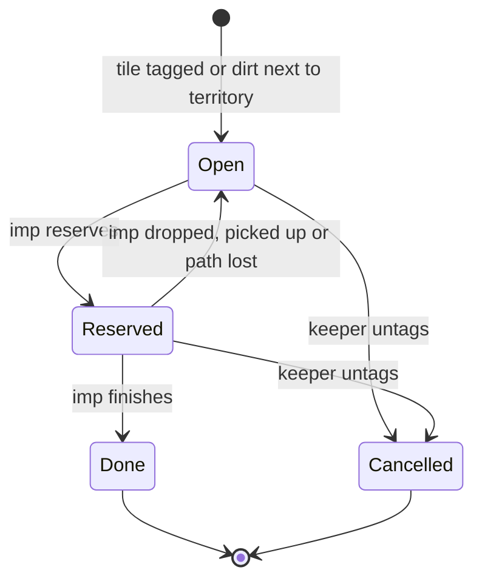
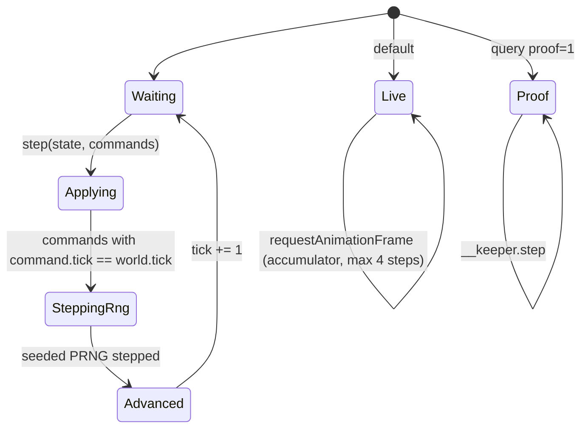

# keeper: design

Living document. Change it in the same PR as the code that changes the design.

## Pitch

You are an underground keeper. You point at rock, your imps dig it out, the dug floor becomes yours, you carve rooms, gold flows into your treasury, and creatures move in. It plays in a browser tab, in 3D, with a free camera like Dungeon Keeper (1997).

## The Dungeon Keeper loop

1. **Tag** rock tiles for digging.
2. **Imps** pick jobs from a shared job board: dig, mine gold, claim floor, reinforce walls, carry gold.
3. **Dug** earth becomes unclaimed dirt. Imps **claim** dirt that touches your territory.
4. You **build rooms** on claimed floor: treasury, lair, hatchery, training room. Rooms cost gold per tile.
5. **Gold** mined from seams is carried to the treasury.
6. **Creatures** arrive through a portal, need a lair and food, and wander, train, sleep.
7. **Hand of Evil**: pick up imps and creatures, drop them elsewhere, slap them to speed them up.
8. **Possession** (later): drop into one creature and play first person.

## Milestone 1: sandbox

Free play. No objective, no defeat, no enemies.

In scope:

- One fixed 64x64 map: earth, impenetrable rock, gold seams, a dungeon heart, a starting patch of claimed floor.
- Free 3D camera: pan, rotate, zoom, tilt. Mouse plus keyboard first. Touch later.
- Tag and untag tiles for digging.
- Imps: dig, mine gold, carry gold, claim dirt. Idle imps wander.
- Rooms: treasury only, painted on claimed floor, paid in gold.
- Hand of Evil: pick up and drop imps, slap.
- A sandbox panel to spawn imps and add gold.
- HUD: gold, imp count, sim tick.

Out of scope for milestone 1: combat, enemy keepers, creatures other than imps, spells, traps, doors, possession, sound, saving, multiplayer, localization.

## Tech stack

- **TypeScript (strict)**, built with **Vite**. tibo.dog ships as a Vite (rolldown) build with a separate `sim` chunk, so the same shape is proven for this kind of game.
- **Three.js** (WebGLRenderer first; WebGPURenderer can come later behind a flag). It draws the scene. The simulation is ours.
- **XState v5** for app-level and input/camera mode charts only (see below).
- **Vitest** for unit, property (fast-check) and snapshot ("expect") tests.
- **Playwright** for headless browser screenshots and gameplay videos.
- **TLA+** via the pstack `statechart` skill for the charts that carry the most risk.

SceneKit and RealityKit were the original idea. They run only on Apple platforms, so the web pivot rules them out.

## Architecture

```text
input (DOM events) --> commands --> sim (fixed step, pure, deterministic) --> snapshot
                                                                     |
                                       render (Three.js, reads only) <--+
app chart (XState) owns: boot, loading, sandbox, paused, WebGL lost
```

- **sim** is plain TypeScript with no DOM and no Three.js imports. It advances in fixed steps of 1/20 s (20 ticks per second). It owns a seeded PRNG, typed arrays for tiles, and a flat array of agents. Given the same seed and the same command log it produces the same state, bit for bit.
- **render** reads the sim snapshot and interpolates between the last two ticks. It never writes sim state.
- **input** turns DOM events into typed commands with the tick they apply on. Commands are the only way to change the sim. A replay is a seed plus a command log.
- **app** is an XState chart around the whole thing.

### Statechart library decision

Sim entities (imps, tiles, jobs) use hand-rolled typed state machines: a discriminated union per entity plus a pure transition function, run in the fixed-step loop. App flow, input modes and camera modes use XState v5.

Why, in one sentence: XState allocates a new snapshot on every transition (about 1.6M events/s in the Dunky benchmark), which suits a few low-frequency UI charts but not hundreds of imps stepping 20 times per second in a zero-allocation, deterministic hot loop.

Rule that follows: every chart, hand-rolled or XState, has a Mermaid diagram in this doc and an exhaustive `switch` with a `never` check. The risky ones also get a TLA+ spec.

### Chart 1: app and game mode (XState)



While `Paused` or `ContextLost`, the sim does not step. The sim tick counter proves it in tests.

### Chart 2: input and camera mode (XState)



Zoom (wheel) works in every state and does not change state.

### Chart 3: tile lifecycle (hand-rolled, sim)



Illegal states this design rules out: rock that is tagged, a room on unclaimed floor, a claimed tile with no claimed neighbour path to the heart.

### Chart 4: imp behaviour (hand-rolled, sim)



Each state carries only the data it needs, for example `{ kind: "walking", jobId, path, step }`. A slap is an effect (a speed boost timer), not a state.

### Chart 5: job lifecycle (hand-rolled, sim)



Invariant: at most one imp reserves a job, and a reserved job points at a live imp that points back at it. This is the first chart to get a TLA+ spec, because two imps racing for one tile is the classic bug.

Job priority follows KeeperFX's digger stack in spirit: dig tagged tiles, then mine gold, then carry gold, then claim dirt, then reinforce.

### Data shapes (summary)

- `TileGrid`: `Uint8Array` kind plus `Uint16Array` gold left, indexed `y * width + x`. No per-tile objects.
- `Imp`: discriminated union on `state.kind`, stored in a preallocated pool.
- `JobBoard`: fixed-size pool with free list; jobs referenced by index, never by object.
- `Command`: discriminated union (`tag`, `untag`, `paintRoom`, `pickUp`, `drop`, `slap`, `spawnImp`, `addGold`), each with `tick`.
- Branded ids: `TileIndex`, `ImpId`, `JobId`, `Tick`. A raw number cannot be passed where an id is expected.

### Chart 0: sim step and render loop

The sim is a hand-rolled loop: at each tick, apply commands whose `tick` equals `world.tick` (stable order), step the seeded PRNG, then increment `tick`. Commands never apply mid-tick. A run is a seed plus a command log; `hashWorld` is stable for that pair. Sim core currently applies `noop`, `addGold`, `tag` and `untag`. Chart 2 `Tagging` queues those tile commands; `setTile` is the only writer of the grid (`World.tiles` is read-only). `tag` on earth or gold seam becomes tagged earth or tagged gold; `tag` on rock (and any non-diggable kind) is refused; `untag` reverses a tag.

Live play uses a fixed-step accumulator (dt 1/20 s, frame delta clamped to 100 ms, at most 4 sim steps per frame). Proof mode (`?proof=1`) never reads real time: Playwright calls `window.__keeper.step(n)`, which advances n sim ticks and draws once.



### Rendering

- Tile drawing lives in `src/render/`. It reads the sim `Uint8Array` grid and never writes sim state.
- One `InstancedMesh` per tile kind (eight kinds, including tagged earth and tagged gold). Sync packs live tiles densely and sets `mesh.count` to the number of tiles of that kind, so tile draw calls stay at most 8. `syncMap` skips when `world.tilesVersion` matches the last packed version. Tagged kinds use a brighter emissive material. Picking maps a camera ray to the ground plane, then to a tile index.
- A later pass can switch to tile-index instances with scale 0 for removed blocks; counts must still match the grid.
- Imps are instanced too. Animation is cheap vertex or transform motion, no skinned meshes in milestone 1.
- Camera: perspective, orbit around a ground target. Pitch is clamped to `[0.2, 1.35]` rad, zoom (distance) to `[12, 90]`, and the ground target to the map rectangle `[-MAP_HALF, MAP_WIDTH - MAP_HALF]` × `[-MAP_HALF, MAP_HEIGHT - MAP_HALF]`. Modes follow chart 2 in `src/input`; pose math lives in `src/camera`.
- Visual style: low-poly blocks, moody dungeon light (one heart point light plus dim hemisphere and ambient), darker per-kind materials, no external art assets in milestone 1 (geometry and colours from code, like tibo.dog's code-only art).

## Open questions

- Pathfinding: grid A* per job, or one flow field per job type. Decide with a benchmark at 200 imps.
- Run the sim in a Web Worker now or later. Start on the main thread. The sim API is message-shaped so moving it is cheap.
