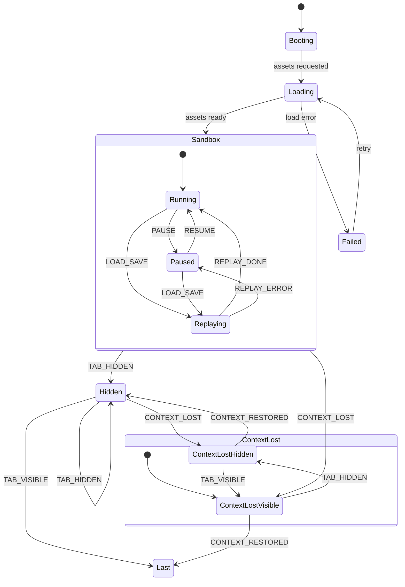
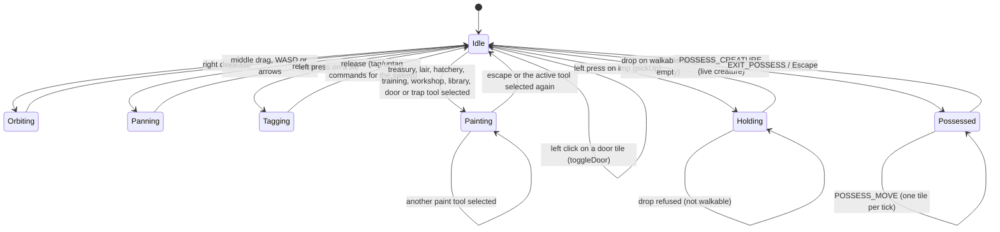
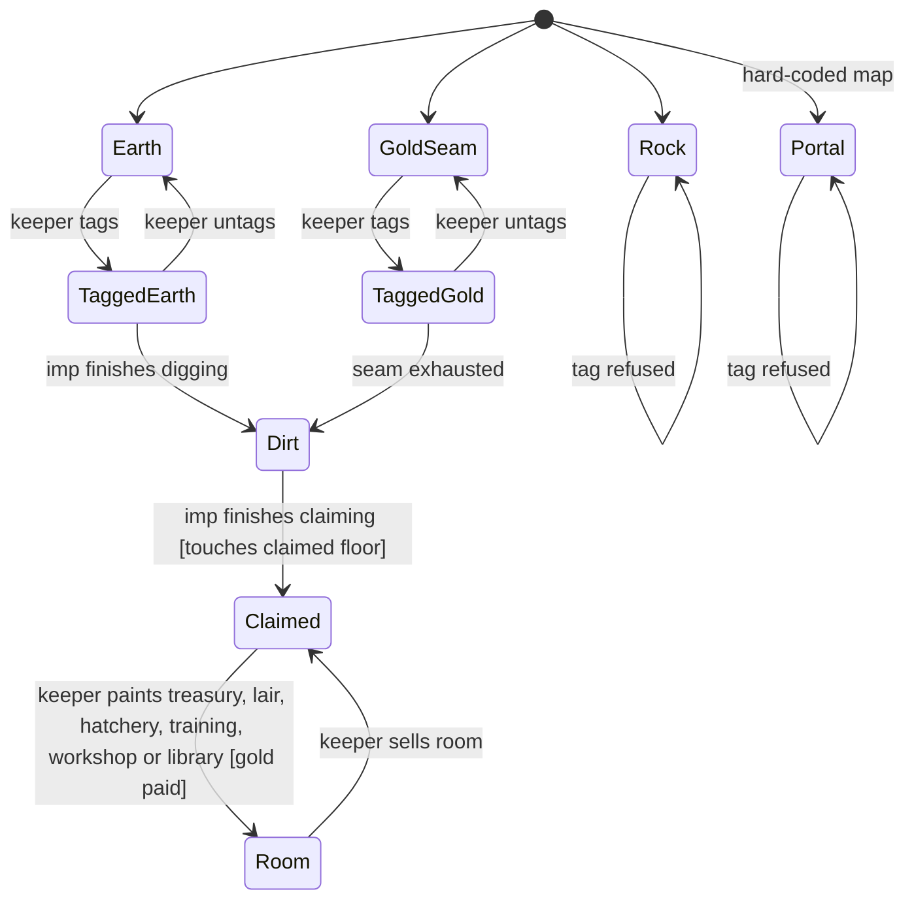
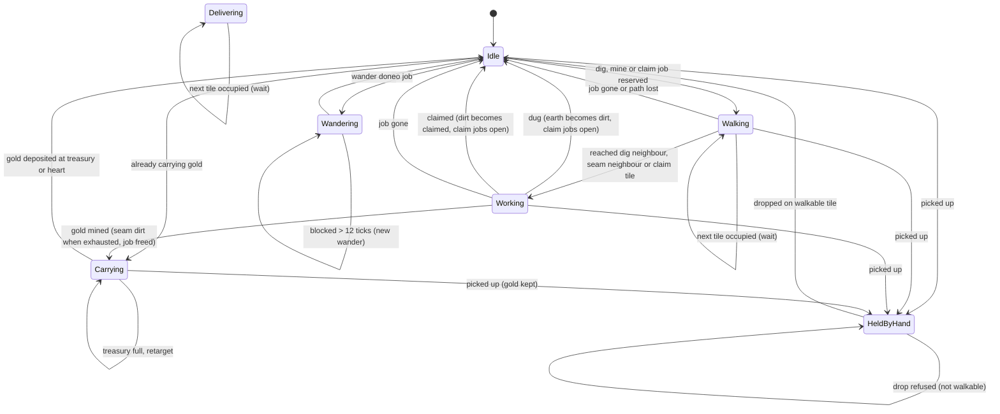
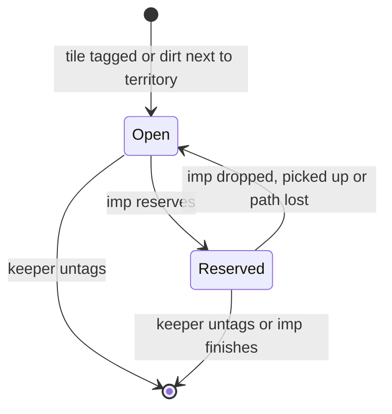
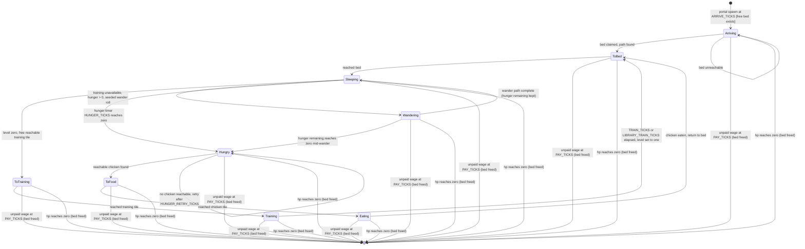
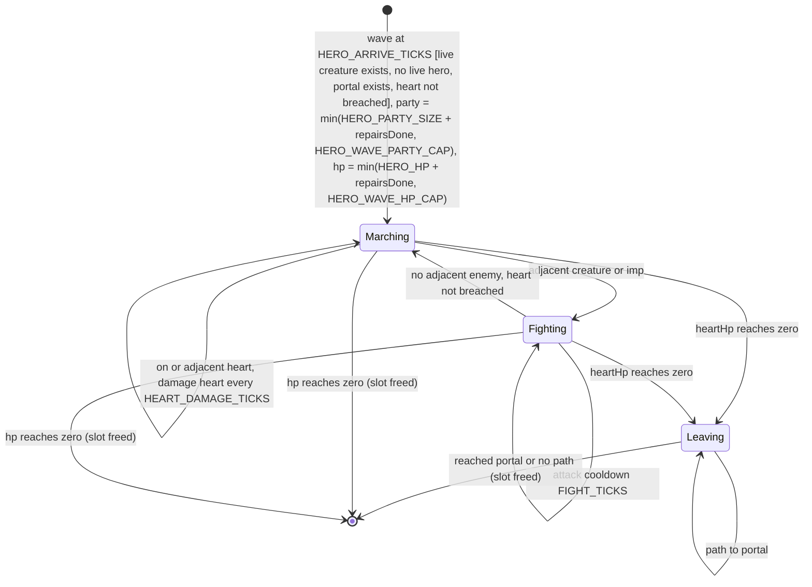
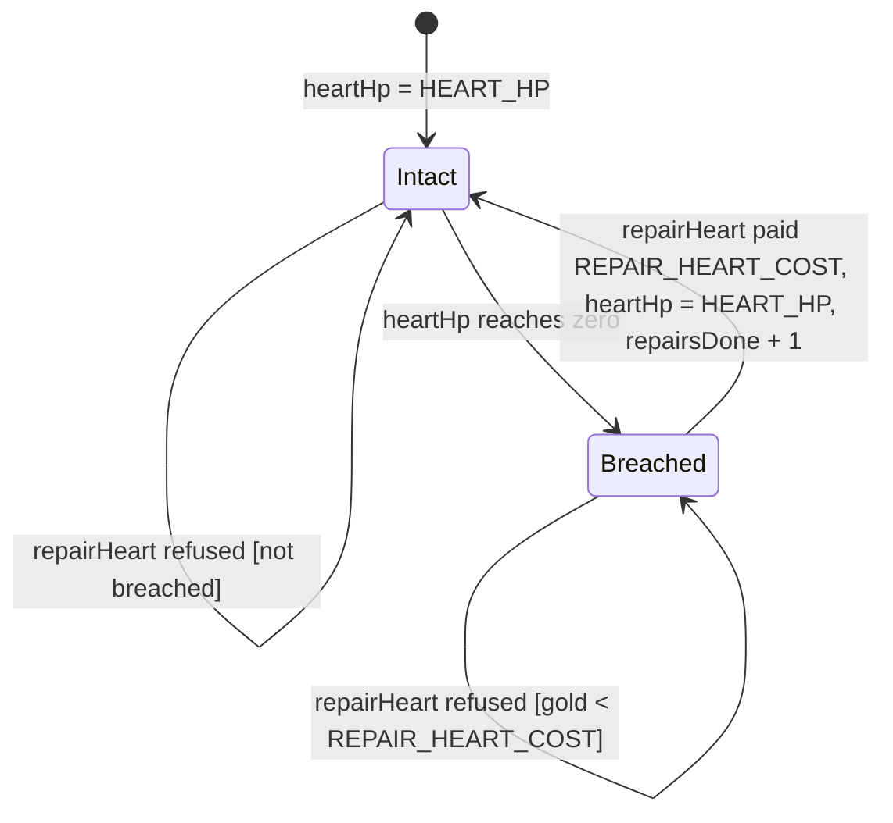
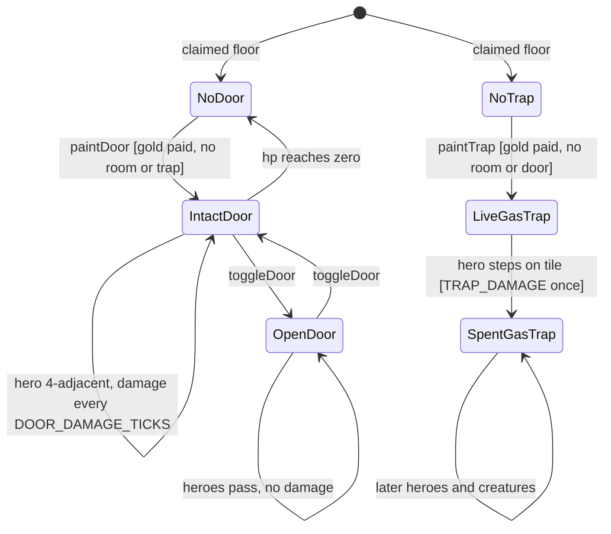
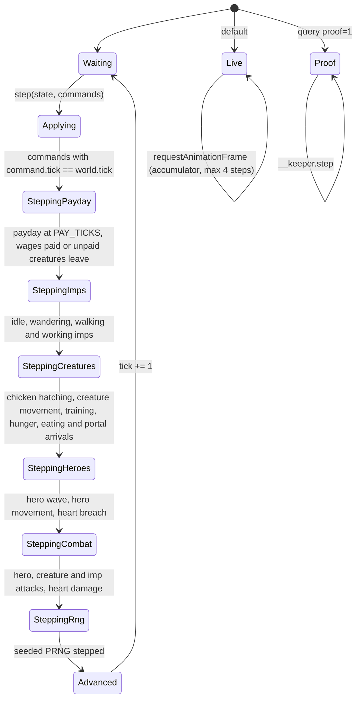

# keeper: design

Living document. Change it in the same PR as the code that changes the design.

## Pitch

You are an underground keeper. You point at rock, your imps dig it out, the dug floor becomes yours, you carve rooms, gold flows into your treasury, and creatures move in. It plays in a browser tab, in 3D, with a free camera like Dungeon Keeper (1997).

## The Dungeon Keeper loop

1. **Tag** rock tiles for digging.
2. **Imps** pick jobs from a shared job board: dig, mine gold, claim floor, reinforce walls, carry gold.
3. **Dug** earth becomes unclaimed dirt. Imps **claim** dirt that touches your territory.
4. You **build rooms** on claimed floor: treasury, lair, hatchery, training room, workshop and library. Rooms cost gold per tile.
5. **Gold** mined from seams is carried to the treasury.
6. **Creatures** arrive through a portal, need a lair and food, and wander, train, sleep.
7. **Hand of Evil**: pick up imps and creatures, drop them elsewhere, slap them to speed them up.
8. **Possession**: drop into one creature and play first person.

## Milestone 1: sandbox

Free play. No objective, no defeat, no enemies.

In scope:

- One fixed 64x64 map: earth, impenetrable rock, gold seams, a dungeon heart, a starting patch of claimed floor, and one portal at `(32,35)` just south of the starting patch.
- Free 3D camera: pan, rotate, zoom, tilt. Mouse plus keyboard first. Touch later.
- Tag and untag tiles for digging.
- Imps: dig, mine gold, carry gold, claim dirt. Idle imps wander.
- Rooms: treasury, lair, hatchery, training, workshop and library, painted on claimed floor, paid in gold.
- Doors and gas traps: painted on claimed floor as overlays, paid in gold. Doors block hero pathfinding until their HP breaks; imps, creatures and possessed creatures pass through. A live gas trap damages the first hero to step on it once.
- Creatures: a fly or beetle arrives through the portal every `ARRIVE_TICKS`, claims the smallest free lair tile and walks there to sleep. The seeded arrival roll picks the kind. A sleeping creature with no training level may walk to a free training tile, train for `TRAIN_TICKS`, gain level one and return to its bed. After `HUNGER_TICKS` it seeks a chicken from a hatchery and eats it.
- Doors and gas traps: painted on claimed floor as overlays, paid in gold. Closed doors block hero pathfinding until their HP breaks or the keeper toggles them open; open doors let heroes through. Imps, creatures and possessed creatures pass through either way. A live gas trap damages the first hero to step on it once.
- Creatures: one fly kind arrives through the portal every `ARRIVE_TICKS`, claims the smallest free lair tile and walks there to sleep. A sleeping creature with no training level may walk to a free training tile, train for `TRAIN_TICKS`, gain level one and return to its bed. After `HUNGER_TICKS` it seeks a chicken from a hatchery and eats it.
- Heroes: a party of `HERO_PARTY_SIZE` heroes enters through the portal every `HERO_ARRIVE_TICKS` while a live creature exists, no hero wave is alive and the heart is not breached. Heroes march toward the heart, fight adjacent creatures or imps, and attack the heart when they are on or next to it. The heart has `HEART_HP` hit points; at zero it is breached and the surviving heroes leave through the portal. The sandbox panel can repair a breached heart for `REPAIR_HEART_COST`, restoring its HP and allowing waves again. This is a sandbox skirmish with no defeat or victory screen.
- Payday: every `PAY_TICKS` each live creature owes `CREATURE_WAGE` from the treasury; a creature that cannot be paid leaves and frees its bed.
- Hand of Evil: pick up and drop imps, slap.
- Possession: double-click a live creature to enter it, WASD or arrows move it one walkable tile at a time, Escape returns to the free camera.
- A sandbox panel to spawn imps and add gold.
- HUD: owned gold (stored plus treasury stock), imp count, sim tick, and the countdown to the next payday.

Out of scope for milestone 1: enemy keepers, creature kinds beyond fly and beetle, creature levels above one, spells, trap kinds other than gas, sound, saving, multiplayer, localization. Unpaid creatures leaving, hero skirmishes and possession are in scope for the sandbox.

## Milestone 2: look like Dungeon Keeper

Pitch: keep the sandbox sim; make the scene read as a DK-inspired underground dungeon. The look is inspired only: procedural or hand-authored textures and meshes that we own, never copied Bullfrog or EA assets.

Axes:

- Floors and walls: floor textures plus cave wall faces on dug edges.
- Low-poly silhouettes for imps, fly, beetle and heroes.
- Torch point lights, darker falloff and optional fog: a warm heart light plus a fixed six-light pool at room anchors, short distance and decay 2, unused lights at zero intensity, and optional dark `FogExp2` behind an exported constant; fill light and fog are tuned for periphery readability while keeping short-distance warm falloff.
- Readable room props: treasury piles, lair beds, hatchery chickens.
- HUD and panel restyled toward a classic DK dark stone panel using HTML/CSS.

Constraints:

- drawCalls ≤ 7 through an atlas and shared materials.
- First-load JS ≤ 300 KB gzip.
- InstancedMesh for repeated geometry.
- `*.hot.ts` files stay allocation-free.
- The sim stays pure.
- No comments and no `any`.

## Tech stack

- **TypeScript (strict)**, built with **Vite**. tibo.dog ships as a Vite (rolldown) build with a separate `sim` chunk, so the same shape is proven for this kind of game.
- **Three.js** (WebGLRenderer first; WebGPURenderer can come later behind a flag). It draws the scene. The simulation is ours.
- **XState v5** for app-level and input/camera mode charts only (see below).
- **Vitest** for unit, property (fast-check) and snapshot ("expect") tests.
- **Playwright** for headless browser screenshots and gameplay videos.
- **TLA+** via the pstack `statechart` skill for the charts that carry the most risk.

SceneKit and RealityKit were the original idea. They run only on Apple platforms, so the web pivot rules them out.

## Architecture

```text
input (DOM events) --> commands --> sim (fixed step, pure, deterministic) --> snapshot
                                                                     |
                                       render (Three.js, reads only) <--+
app chart (XState) owns: boot, loading, sandbox, paused, WebGL lost
```

- **sim** is plain TypeScript with no DOM and no Three.js imports. It advances in fixed steps of 1/20 s (20 ticks per second). It owns a seeded PRNG, typed arrays for tiles, and a flat array of agents. Given the same seed and the same command log it produces the same state, bit for bit.
- **render** reads the sim snapshot and interpolates between the last two ticks. It never writes sim state.
- **input** turns DOM events into typed commands with the tick they apply on. Commands are the only way to change the sim. A replay is a seed plus a command log.
- **app** is an XState chart around the whole thing.

### Statechart library decision

Sim entities (imps, creatures, tiles, jobs) use hand-rolled typed state machines: a discriminated union per entity plus a pure transition function, run in the fixed-step loop. App flow, input modes and camera modes use XState v5.

Why, in one sentence: XState allocates a new snapshot on every transition (about 1.6M events/s in the Dunky benchmark), which suits a few low-frequency UI charts but not hundreds of imps stepping 20 times per second in a zero-allocation, deterministic hot loop.

Rule that follows: every chart, hand-rolled or XState, has a Mermaid diagram in this doc and an exhaustive `switch` with a `never` check. The risky ones also get a TLA+ spec.

### Chart 1: app and game mode (XState)



`Hidden` is a non-manual suspended state for a hidden tab. `isPaused` is true only for the manual `Paused` state, so a hidden tab does not show the pause overlay. `isSimStepping` is false in `Hidden`, `ContextLost`, `Paused` and `Replaying`; the sim tick counter proves it in tests.

The `Sandbox.Last` history state remembers the last of `Running`, `Paused` and `Replaying`. `TAB_VISIBLE` from `Hidden` returns there, and `CONTEXT_RESTORED` from `ContextLostVisible` returns there, so a manual pause stays paused and a running game stays running. `ContextLostHidden` records that the tab is still hidden: `TAB_VISIBLE` moves it to `ContextLostVisible`, while `CONTEXT_RESTORED` returns to `Hidden` until the tab becomes visible. Both orders of `TAB_HIDDEN` and `CONTEXT_LOST` therefore preserve the remembered `Running` or `Paused` state, and `PAUSE`/`RESUME` are ignored while suspended.

Loading a save enters `Replaying`, replaces the world, seed and command log, steps the imported `CommandLog` to the saved tick through the chart, then sends `REPLAY_DONE` (or `REPLAY_ERROR`). Replay is synchronous inside that load, so hide or context loss is not normally observed during `Replaying`; if one does interleave, the history returns to `Replaying`.

### Chart 2: input and camera mode (XState)



`SELECT_PAINT_TOOL` carries the paint tool (`treasury`, `lair`, `hatchery`, `training`, `workshop`, `library`, `door` or `trap`) and the painter emits that tool with every tile: rooms emit `paintRoom`, doors emit `paintDoor` and traps emit `paintTrap`. Selecting a different tool while Painting switches to it without leaving Painting, and selecting the active tool again clears it. Painting applies on left click and drag while the primary button is held, not on hover. Zoom (wheel) works in every state and does not change state. The hand holds at most eight imps; a left press on another imp while holding picks it up too. A right press while holding drops the most recently picked imp, or stays holding when the tile is not walkable. A Shift+left press on an imp while Idle queues `slap` and does not pick it up; Shift has no effect while Holding or Painting. A left click on a tile with an intact door while Idle queues a zero-cost `toggleDoor` that flips the door open or closed without changing its HP.

`POSSESS_CREATURE` carries a `creatureId` and is accepted from Idle for a live creature: double-clicking a live creature tile, or the panel Possess button picking the first sleeping or live creature, queues `possess` and enters Possessed. While Possessed, tagging, painting and hand pickup are disabled: `LEFT_DOWN_TILE`, `LEFT_DOWN_IMP`, `SELECT_ROOM_TOOL` and the camera gestures are ignored, and the panel paint buttons are disabled. WASD and arrow keys queue at most one `possessMove` for the possessed id per tick; the sim refuses diagonal, non-possessed, non-walkable and out-of-bounds moves. The camera follows the possessed creature and returns to the orbit pose on `EXIT_POSSESS` or Escape, which queue `releasePossess`. If the possessed creature dies, the sim clears possession and the input bind returns to Idle on its next tick.

### Chart 3: tile lifecycle (hand-rolled, sim)



Illegal states this design rules out: rock that is tagged, a room on unclaimed floor, a claimed tile with no claimed neighbour path to the heart, a portal that gets overwritten. Doors and traps are not tile kinds: they are parallel overlays on claimed floor, so painting one never rewrites the tile kind. A tile cannot hold a room, a door and a trap at the same time.

### Chart 4: imp behaviour (hand-rolled, sim)



Each state carries only the data it needs, for example `{ kind: "walking", tile, path, step }` and `{ kind: "working", tile, remaining }`. A slap is an effect, not a state: a live non-held imp gets `{ kind: "boosted", remaining: SLAP_TICKS }` with `SLAP_TICKS = 60`, re-slapping resets it, and movement or work advances at double speed until it reaches zero. `pickUp` clears the boost, so held imps are never boosted. Imps never store a `JobId`: walking and working keep the job tile and re-check `jobHeldBy` every tick.

Carrying imps choose the nearest reachable treasury tile with free capacity from the single walkability flood, then fall back to the heart. Delivery deposits up to `TREASURY_CAPACITY` into that tile; excess stays carried and the imp retargets. The treasury tile list is cached by `tilesVersion`, so delivery never rescans the map. Gold conservation counts seams, carried gold (including held imps), `goldStored`, treasury stock and `goldSpent` exactly.

Walkable tiles: claimed floor, dirt, rooms and the portal. Earth, gold seams, tagged earth, tagged gold and rock are not walkable. Idle imps first try to reserve an open `dig` job. If one is reserved, they BFS to a reachable walkable tile 4-adjacent to the job tile and walk there; if no neighbour is reachable they release the job and wander. Working imps count down `DIG_TICKS = 40`, then turn the tagged earth into dirt and free the job. A dig or claim job whose tile is within Chebyshev distance one of a workshop tile starts with `WORKSHOP_DIG_TICKS = 20` or `WORKSHOP_CLAIM_TICKS = 15` instead, so it finishes in half the time. The workshop tile list is cached by `roomsVersion`, and the check runs only when an imp starts work; mining gold is never boosted. If the job disappears mid-walk or mid-work, the imp returns to idle immediately. Idle imps with no job wander: pick a random reachable walkable tile with the seeded RNG, then follow a 4-neighbour grid path (BFS) one tile at a time. The sandbox starts with four imps on the heart's claimed patch. The Hand of Evil holds at most eight imps: `pickUp` releases any reserved job back to `Open` and takes the imp off the grid in the `held` state, keeping any carried gold unchanged; `drop` is accepted only on a walkable tile and returns the imp to idle there with its carry intact, so a dropped carrier walks its gold to the heart, while a refused drop leaves it held. Both commands apply at tick boundaries like every other command. `slap` is refused for held imps and empty slots, costs nothing, and applies the speed boost; `pickUp` clears any boost. Hand capacity, job release, boost bounds and the held-never-boosted rule are checked in `specs/HandOfEvil.tla`. Each imp board carries a preallocated per-tile occupancy count that spawn, move, pick-up and drop keep exact; imps wait at tile boundaries for occupied tiles except the heart, a delivery target tile, the final tile of a walking or delivering path, and maps where live imps outnumber walkable tiles, while wanderers prefer unoccupied destinations and re-pick after more than 12 blocked ticks. Creatures are not part of the imp occupancy grid: only live imps are counted.

### Chart 5: job lifecycle (hand-rolled, sim)



Slots are freed immediately, so there is no `done` or `cancelled` state on the board. Invariant: at most one worker reserves a job, a worker holds at most one job, and a cancelled or finished job has no holder. This is the first chart with a TLA+ spec (`specs/JobReservation.tla`), because two workers racing for one tile is the classic bug. Reservation is a sim function on branded `WorkerId` values, and imps map their `ImpId` to a `WorkerId` through one helper.

Job priority follows KeeperFX's digger stack in spirit: dig tagged tiles, then mine gold, then carry gold, then claim dirt, then reinforce. Tagging earth opens a `dig` job; tagging gold opens `mineGold`. Untag cancels the job at that tile, including a reserved one. The job list is the occupied pool slots in index order and is mixed into `hashWorld`; a per-tile slot index makes `jobAtTile` and `openJob` lookups constant time without scanning the pool.

### Chart 6: creature lifecycle (hand-rolled, sim)



A creature spawns only as a sim effect of `step`, never as a command. The portal is a walkable tile at `(32,35)`; when the world tick is a multiple of `ARRIVE_TICKS = 200`, a new creature spawns if the portal exists, live creatures are below `CREATURE_CAPACITY = 8`, and at least one lair tile has no live creature claiming it. The kind is a `CreatureKind` of `fly` or `beetle`, stored on the live creature and picked with the seeded RNG after a free bed is found: `world.rng % 2 === 0` selects fly and the other parity selects beetle. Bed choice is deterministic: the free lair tile with the smallest tile index from the `roomsVersion`-cached lair list. A creature stores its `bedTile` for its whole life, so a bed is free iff no live creature has that `bedTile`. Arrival kind, path, state and bed claim are included in `hashWorld`. Both kinds share the same lifecycle, training, hunger, payday, possession and combat rules; only HP and rendering differ. The single-writer arrival loop makes bed uniqueness a unit-test invariant rather than a TLA+ concurrency spec.

A sleeping creature with `level = 0` first looks for a free training tile. The training tile list is cached by `roomsVersion`, like the lair and hatchery lists. A tile is free iff no live creature is in `toTraining` or `training` for that tile, so one creature reserves one training tile. The creature uses the single walkability flood, picks the smallest free reachable training tile, walks there and trains for `TRAIN_TICKS = 80`. When the training tile is within Chebyshev distance one of a library tile it trains for `LIBRARY_TRAIN_TICKS = 40` instead; the library tile list is cached by `roomsVersion` and refreshed only when training starts, so the aura costs no per-tick map scan. On completion it sets `level = 1` and returns to its bed; `bedTile` never changes, so its bed stays owned while it trains. Training rooms cost `TRAINING_COST = 40` per claimed tile and library tiles cost `LIBRARY_COST = 55` per claimed tile. `CREATURE_MAX_LEVEL` stays one. Training creatures are live creatures, so payday still charges them and an unpaid training creature leaves and frees its bed.

A sleeping creature whose training check fails may wander when its hunger timer is a positive multiple of `WANDER_PERIOD = 40` and a seeded roll of `WANDER_CHANCE = 1` out of `WANDER_ROLL = 2` succeeds. It picks a seeded random reachable walkable tile other than its current tile, walks there on a 4-neighbour path, and returns to sleeping with the same hunger remaining when the path completes; if no other reachable walkable tile exists it stays sleeping. `bedTile` never changes, so its bed stays owned while it wanders. The hunger timer keeps counting down during the wander: each wandering tick decrements the stashed remaining, and if it reaches zero mid-path the creature drops the path and becomes hungry immediately.

A possessed creature keeps its state and bed but skips its autonomous AI step entirely, including arrival, training, wander and hunger; it moves only through `possessMove` until `releasePossess` or death clears possession.

A sleeping creature that is not training counts down `HUNGER_TICKS = 300`. When it reaches zero the creature is hungry and uses the single walkability flood to pick the nearest reachable live chicken, tie-breaking by chicken id, then reconstructs the path to that hatchery tile. `HUNGER_RETRY_TICKS = 40` throttles retries when no chicken is reachable. Eating counts down `EAT_TICKS = 20`, then removes that chicken from the board and returns the creature to its bed. Chickens spawn only as a sim effect of `step`: every `HATCH_TICKS = 100`, each hatchery tile under `CHICKEN_TILE_CAP = 2` live chickens receives one chicken in the first empty `ChickenBoard` slot, up to `CHICKEN_CAPACITY = 32`. The hatchery tile list is cached by `roomsVersion`; the chicken board and the per-tile chicken count are maintained exactly and hashed. The Hand of Evil and slap still apply only to imps.

Every `PAY_TICKS = 450` ticks the world runs a payday before imps and creatures step. In stable creature id order it pays `CREATURE_WAGE = 10` from treasury stock (the smallest tile index with stock first) and then from `goldStored`. Paid wages increase `goldPaidOut`; they are not `goldSpent`, so gold conservation is seams, carried gold, `goldStored`, treasury stock, `goldSpent` and `goldPaidOut`. If the full wage cannot be paid, the creature leaves immediately: its slot becomes empty and its bed is free for a later portal arrival. Leaving is sandbox behaviour, not combat, and there is no defeat. `freeBedTiles` reports beds no live creature claims.

### Chart 7: hero lifecycle (hand-rolled, sim)



A hero wave spawns only as a sim effect of `step`, never as a command. When the world tick is a positive multiple of `HERO_ARRIVE_TICKS = 500`, at least one live creature exists, no live hero remains, the portal still exists and the heart is not breached, the next wave party size is `min(HERO_PARTY_SIZE + repairsDone, HERO_WAVE_PARTY_CAP)` heroes, where `HERO_PARTY_SIZE = 2` and `HERO_WAVE_PARTY_CAP = 5`; the first wave before any repair stays at 2. Spawned heroes start at `hp = maxHp = min(HERO_HP + repairsDone, HERO_WAVE_HP_CAP)`, where `HERO_HP = 4` and `HERO_WAVE_HP_CAP = 6`; the first wave has 4 hp and later waves rise to 5, then cap at 6. `repairsDone` increments only when a `repairHeart` command is paid and clears the breach. Heroes spawn in the first empty slots. Spawn tiles are deterministic: the portal tile for the first member, then the nearest remaining walkable tile by Chebyshev distance from the portal, then tile index, skipping tiles occupied by a live hero. The pool holds `HERO_CAPACITY = 8` heroes. Heroes never claim a lair bed. A marching hero uses the single walkability flood to path to the heart first; when the heart is unreachable it falls back to the nearest reachable live creature by distance then creature id, then to the nearest reachable claimed tile by distance then tile index. A hero fights any adjacent creature or imp, then resumes marching to the heart when no adjacent enemy remains. The hero flood treats closed intact door tiles as blocked, so a closed door can cut the route to the heart; the hero then paths to the nearest reachable claimed tile and attacks an adjacent closed intact door. Open doors are walkable for heroes and are never damaged. When a door closes on a marching hero's remaining path, the next path rebuild avoids it and the hero attacks it if no other route exists. Door damage uses `DOOR_DAMAGE_TICKS = 4` and clears the overlay at zero, after which the next march step can path through. A hero that steps onto a live gas trap takes `TRAP_DAMAGE = 2` once and the trap becomes spent; the damage can clear the hero slot. Heroes are not part of the imp occupancy grid. After the heart is breached no new wave spawns until it is repaired.

### Chart 8: heart lifecycle (hand-rolled, sim)



A `repairHeart` command is accepted only at a tick boundary, only while `heartBreached` is true, and only when the player owns at least `REPAIR_HEART_COST = 100` gold across stored gold and treasury stock. Payment drains `goldStored` first, then treasury stock from the smallest tile index, and adds exactly `REPAIR_HEART_COST` to `goldSpent`; a refused repair mutates nothing. A successful repair sets `heartHp = HEART_HP`, leaves `heartMaxHp` unchanged, clears `heartBreached`, and increments `repairsDone`, so the existing `HERO_ARRIVE_TICKS` wave gate can spawn parties again with the escalated party size and hp caps.

### Chart 9: door and trap overlays (hand-rolled, sim)



Doors cost `DOOR_COST = 50`, start closed at `DOOR_HP = 8`, and can be toggled open or closed by a zero-cost `toggleDoor` command without changing HP. A closed door tile stays claimed but is blocked for hero pathfinding and hero movement while `doorHp > 0`; an open door is walkable for heroes. Imps, creatures and possessed creatures use normal walkability and pass through either way. Heroes adjacent to a closed intact door damage it by `COMBAT_DAMAGE` every `DOOR_DAMAGE_TICKS = 4`; heroes never damage open doors. At zero the overlay clears and the door state resets to closed so the tile becomes ordinary claimed floor again. The door HP and open-state arrays are hashed. Traps cost `TRAP_COST = 40`; gas is the only v1 trap kind. A live gas trap deals `TRAP_DAMAGE = 2` once to the first hero that occupies its tile, then becomes spent. Imps and creatures ignore traps. All three overlays are `Uint8Array`s on the world, included in `hashWorld`, and doors and traps are exposed through `doorCount` and `trapCount`.

### HP and combat

Creatures start with `hp = maxHp = CREATURE_HP = 3` for a fly or `hp = maxHp = BEETLE_HP = 5` for a beetle; completing training sets level one and adds `CREATURE_HP_PER_LEVEL = 1` to both. Imps start with `hp = maxHp = IMP_HP = 2`. Heroes start with `hp = maxHp = HERO_HP = 4`; a wave after repairs starts at `min(HERO_HP + repairsDone, HERO_WAVE_HP_CAP)`, capped at 6. `hp`, `maxHp` and `attackCooldown` are part of each entity's hash.

Combat resolves once per tick after movement in stable order: heroes by slot id, then creatures by slot id, then imps by slot id. Adjacency is the same tile or a 4-neighbour. Each attacker deals `COMBAT_DAMAGE = 1` when its `attackCooldown` is zero and then sets it to `FIGHT_TICKS = 20`; a cooldown above zero counts down by one each tick. A hero with no adjacent unit and no adjacent foe attacks the heart when it is on or 4-adjacent to it, unless the heart tile itself has an intact door; in that case it damages that door first. When the heart is not adjacent it damages an adjacent intact door, setting `attackCooldown = DOOR_DAMAGE_TICKS = 4`; heart damage deals `COMBAT_DAMAGE` and sets `attackCooldown = HEART_DAMAGE_TICKS = 2`, so a hero damages the heart every two ticks. A hero standing on a live gas trap takes `TRAP_DAMAGE = 2` once per trap, independent of combat cooldowns, and the trap becomes spent. The heart starts at `heartHp = heartMaxHp = HEART_HP = 20`. At zero hp the heart is breached: `heartHp = 0`, `heartBreached = true`, and every surviving hero paths to the portal and despawns there, or despawns immediately when no portal path exists. New hero waves are refused while `heartBreached` is true. A paid `repairHeart` restores `heartHp = HEART_HP` and clears `heartBreached`, after which waves resume at the next `HERO_ARRIVE_TICKS` boundary. A creature at zero hp frees its bed and empties its slot, the same leave path as an unpaid creature. An imp at zero hp releases its job, leaves the occupancy grid and empties its slot; carried gold is added to `goldStored` so conservation still holds. A hero at zero hp empties its slot. If every creature, every hero or the heart is lost the sandbox keeps running; there is no defeat or victory UI.

### Data shapes (summary)

- `TileGrid`: `Uint8Array` kind plus `Uint16Array` gold left, indexed `y * width + x`. No per-tile objects. Rooms are a separate `Uint8Array` room kind (`none`, `treasury`, `lair`, `hatchery`, `training`, `workshop`, `library`) and a `Uint16Array` treasury stock, with a `tilesVersion`-keyed treasury tile cache and `roomsVersion`-keyed lair, hatchery, training, workshop and library tile caches. Doors are a parallel `Uint8Array` door HP overlay (`0` means no door, otherwise intact HP) plus a parallel `Uint8Array` door open-state overlay (`0` closed, `1` open); traps are a parallel `Uint8Array` state overlay (`TRAP_NONE`, `TRAP_GAS_LIVE`, `TRAP_GAS_SPENT`). `doorVersion` and `trapVersion` drive render resync; both overlays and the door open state are hashed. The portal is tile kind `portal`. `goldSpent`, `goldPaidOut`, `heartHp`, `heartMaxHp` and `heartBreached` and `repairsDone` are on the world and hashed.
- `Imp`: discriminated union on `state.kind`, including `held`, plus a `boost` slot union (`{ kind: "none" } | { kind: "boosted"; remaining }`) and `hp`, `maxHp`, `attackCooldown`. The pool is empty or live slots (`{ kind: "empty" } | { kind: "live", imp }`), same shape as the job board.
- `JobBoard`: fixed-size pool of empty or filled slots plus a per-tile slot index; jobs referenced by `JobId` (slot index), never by object identity.
- `Hand`: fixed-size pool of empty or held slots carrying an `ImpId`, capped at eight; `hashWorld` includes it.
- `Creature`: slot union `empty | live` in a fixed `CREATURE_CAPACITY` pool, branded `CreatureId`, with a `CreatureKind` of `fly | beetle`, `bedTile`, `level`, `hp`, `maxHp`, `attackCooldown`, tile position, path and a state union `arriving | toBed | sleeping | toTraining | training | wandering | hungry | toFood | eating`. Creatures are hashed with their kind, bed claims, level, HP and hunger state; an unpaid or killed creature's slot becomes empty, which frees its bed and changes the hash.
- `Hero`: slot union `empty | live` in a fixed `HERO_CAPACITY` pool, branded `HeroId`, with `hp`, `maxHp`, `attackCooldown`, tile position, path and a state union `marching | fighting | leaving`; `marching` carries a `goal` union `heart | creature | claimed`. Heroes are hashed with their HP, cooldown, tile, path, state and march goal; a hero at zero hp leaves an empty slot, and a leaving hero frees its slot at the portal.
- `ChickenBoard`: slot union `empty | live` in a fixed `CHICKEN_CAPACITY` pool, branded `ChickenId`, each live chicken carrying its hatchery `tile`; the board, `chickensVersion` and per-tile counts are maintained exactly and hashed.
- `Possession`: slot union `{ kind: "none" } | { kind: "creature"; id: CreatureId }` on the world; `hashWorld` includes it, and the sim clears it when the possessed creature's slot becomes empty.
- `Command`: discriminated union (`tag`, `untag`, `paintRoom`, `paintDoor`, `toggleDoor`, `paintTrap`, `pickUp`, `drop`, `slap`, `spawnImp`, `addGold`, `possess`, `releasePossess`, `possessMove`, `repairHeart`), each with `tick`. Tag and untag update tiles and the job board together. `paintRoom` carries `room: "treasury" | "lair" | "hatchery" | "training" | "workshop" | "library"`; `paintDoor` costs `DOOR_COST = 50` and sets a closed door at `DOOR_HP = 8`; `toggleDoor` costs nothing, is accepted only on an intact door and flips its open state without changing HP; `paintTrap` costs `TRAP_COST = 40` and sets a live gas trap. Both overlays require claimed floor with no room, door or trap conflict. `possess` carries `creatureId` and is refused for an empty slot; `releasePossess` clears the possession slot; `possessMove` carries `creatureId`, `dx` and `dy` with `|dx| + |dy| = 1`, applies only to the possessed creature, and moves it one step when the destination is walkable and in bounds.
- `CommandLog`: a branded, sorted command list. `sortCommands` returns a `CommandLog`; `requireSorted` validates that an existing log is already in stable sorted order; `step` and `run` accept only a `CommandLog`, so an unsorted `Command[]` cannot reach the sim.
- `Save`: `{ version: 1, seed, tick, commands }` with commands sorted by `(tick, original index)`. `buildSave` exports the live seed, tick and command log; `parseSave` validates unknown JSON into `{ ok: true, save } | { ok: false, error }`; `replaySave` recreates the world from the seed and steps the imported log to the saved tick. Export, import and replay live in `src/sim/save.ts`.
- Branded ids: `TileIndex`, `ImpId`, `JobId`, `WorkerId`, `CreatureId`, `ChickenId`, `HeroId`, `Tick`. A raw number cannot be passed where an id is expected.

### Chart 0: sim step and render loop

The sim is a hand-rolled loop: at each tick, apply commands whose `tick` equals `world.tick` (stable order), run a payday when `world.tick` is a positive multiple of `PAY_TICKS`, step imps, step creatures, step hero waves and hero movement, resolve combat, sync possession, step the seeded PRNG, then increment `tick`. Commands never apply mid-tick. A run is a seed plus a `CommandLog`; `hashWorld` is stable for that pair and includes jobs, live imps, creatures, bed claims, the hand, possession, heroes, HP, combat cooldowns, heart HP, breach, repairsDone, door HP, door open state and trap state. A `Save` stores `{ version: 1, seed, tick, commands }`; replaying it from a fresh world must reproduce the live hash and tick. Sim core currently applies `noop`, `addGold`, `tag`, `untag`, `paintRoom`, `paintDoor`, `toggleDoor`, `paintTrap`, `spawnImp`, `pickUp`, `drop`, `slap`, `possess`, `releasePossess`, `possessMove` and `repairHeart`. `paintRoom` carries `room: "treasury" | "lair" | "hatchery" | "training" | "workshop" | "library"`; a lair costs `LAIR_COST = 30`, a treasury costs `TREASURY_COST = 25`, a hatchery costs `HATCHERY_COST = 50`, a training tile costs `TRAINING_COST = 40`, and a workshop tile costs `WORKSHOP_COST = 45`, a library tile costs `LIBRARY_COST = 55`, a door costs `DOOR_COST = 50`, toggling it costs nothing, and a gas trap costs `TRAP_COST = 40`. Repairing a breached heart costs `REPAIR_HEART_COST = 100` and is refused without full payment. Each tick then runs the `PAY_TICKS` payday, steps imps, hatches chickens on hatchery tiles at `HATCH_TICKS`, steps creatures (including the `ARRIVE_TICKS` portal arrival, training, wandering and hunger/eating effects), steps heroes (including the `HERO_ARRIVE_TICKS` wave, door damage and gas-trap damage), resolves combat, syncs possession (clearing it when the possessed slot is empty), and steps the seeded PRNG. A possessed creature skips its autonomous AI step and moves only through `possessMove`. The HUD appends `pay T` for the ticks until the next payday, or `pay now` when one is due, then `heart N` or `breached` for the heart, then `wave N` where `N = repairsDone + 1`. The sandbox panel queues `spawnImp`, `addGold` and `repairHeart` commands through the same command list as the input layer; `spawnImp` fills the first empty imp slot at the heart and is refused at `IMP_CAPACITY`, and `repairHeart` is refused unless the heart is breached and the full cost is available. Chart 2 `Tagging` queues those tile commands; `setTile` is the only writer of the grid (`World.tiles` is read-only). `tag` on earth or gold seam becomes tagged earth or tagged gold and opens a job; `tag` on rock (and any non-diggable kind) is refused; `untag` reverses a tag and cancels the job. `pickUp` releases the imp's reserved job and clears any boost; `drop` writes no tile and only moves the imp onto a walkable tile; `slap` sets the boost timer on a live non-held imp and is refused otherwise. Reserve and release are job-board operations, not commands yet. Pathfinding reads the grid through `TileRead`.
Live play uses a fixed-step accumulator (dt 1/20 s, frame delta clamped to 100 ms, at most 4 sim steps per frame). Proof mode (`?proof=1`) never reads real time: Playwright calls `window.__keeper.step(n)`, which advances n sim ticks and draws once.



### Rendering

- Tile drawing lives in `src/render/`. It reads the sim `Uint8Array` grid and never writes sim state.
- Four grouped `InstancedMesh` draws cover all nine tile kinds: terrain (earth, dirt, tagged earth), gold (seam, tagged gold), rock, and floor (claimed, treasury, lair, hatchery, training, workshop, library, portal). A runtime canvas atlas supplies procedural dirt, claimed stone flags, rock, gold veins, earth top, generic room floor, distinct room floor cells for treasury, lair, hatchery, training, workshop and library, portal floor and cave wall cells through one shared material; a per-instance atlas-cell attribute selects the cell while per-instance colours still tint tagged tiles, treasury, lair, hatchery, training, workshop and library floors, the portal, closed and open doors and live or spent gas traps; open doors use a weaker tint than closed doors; tagged instances pulse brighter inside their existing group. Each high tile (earth, rock, gold or tagged) that borders a walkable floor tile appends one vertical wall-face instance per exposed side into its own tile group, so dug corridors show cave walls with no extra `InstancedMesh` and no extra draw call. Door and trap tiles keep their floor tint, and the shared props `InstancedMesh` adds a wooden frame per door (a full slab with iron bands when closed, a slab swung flat against one post when open) and a stone plate per gas trap (a green vent when live, a dark plate when spent), dirty-synced by `doorVersion` and `trapVersion`, so they add no draw call. `syncMap` packs live tiles densely, sets `mesh.count` per group, and skips repacking when `world.tilesVersion`, `world.roomsVersion`, `world.doorVersion` and `world.trapVersion` match the last packed versions, while still updating the tagged pulse from render time. Picking maps a camera ray to the ground plane, then to a tile index.
- A later pass can switch to tile-index instances with scale 0 for removed blocks; counts must still match the grid.
- Imps are one `InstancedMesh` of low-poly cones, interpolated between the last two ticks. Working imps bob and tilt toward their work tile using render time only, without writing sim state. A freshly slapped imp flashes gold and leans. Held imps are skipped on the grid and drawn floating near the cursor through the same imp mesh. Creatures are one separate `InstancedMesh` of octahedra, also interpolated between ticks; flies are flat green-cyan, beetles are darker amber-brown and wider and lower, and a creature with level one is drawn slightly larger and brighter through the same instance mesh. Heroes reuse that creature `InstancedMesh` with a blue-steel tint and a taller scale, so the hero wave adds no draw call. Treasury gold piles, lair beds, hatchery chickens, doors and gas traps are drawn by one shared props `InstancedMesh`, dirty-synced by `treasuryVersion`, `chickensVersion`, `roomsVersion`, `doorVersion`, `trapVersion` and a render-side fingerprint of occupied bed tiles: each stocked treasury tile gets a stepped amber mound of several boxes scaled by `stock / TREASURY_CAPACITY`, each occupied bed gets a mattress and pillow, and each live chicken gets a body, head and beak on its hatchery tile. Training, workshop and library tiles get small post, anvil and book-stack markers through the same mesh. Closed intact doors get two dark posts, a lintel, a tall slab and iron bands; open doors keep the frame and swing the slab against one post so the passage is empty; live gas traps get a low stone plate with a bright green vent block and spent traps a flat dark plate. The grouped tile meshes plus imps, creatures and props stay within 7 draw calls; room, lair, hatchery, training, workshop, library and portal floors reuse the floor group as per-instance tints rather than adding draw calls.
- Camera: perspective, orbit around a ground target. Pitch is clamped to `[0.2, 1.35]` rad, zoom (distance) to `[12, 90]`, and the ground target to the map rectangle `[-MAP_HALF, MAP_WIDTH - MAP_HALF]` × `[-MAP_HALF, MAP_HEIGHT - MAP_HALF]`. Modes follow chart 2 in `src/input`; pose math lives in `src/camera`. While Possessed, the camera is placed each frame just behind and above the possessed creature using its interpolated `currX`/`currZ` and heading, with no new meshes or draw calls; exiting restores the orbit pose.
- Visual style: low-poly blocks, moody dungeon light (a warm heart point light, a fixed room-anchor torch pool with dark falloff, low hemisphere and ambient, and optional dark `FogExp2`), darker per-kind materials, no external art assets in milestone 1 (geometry and colours from code, like tibo.dog's code-only art).

## Open questions

- Pathfinding: grid A* per job, or one flow field per job type. Decide with a benchmark at 200 imps.
- Run the sim in a Web Worker now or later. Start on the main thread. The sim API is message-shaped so moving it is cheap.
